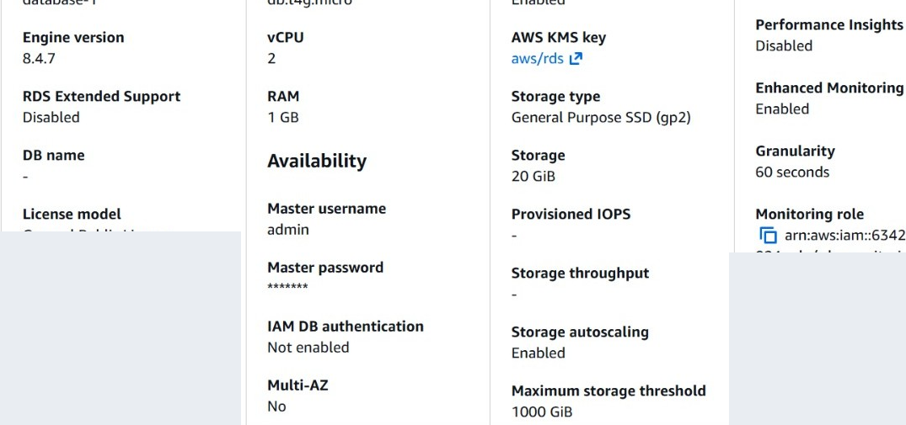
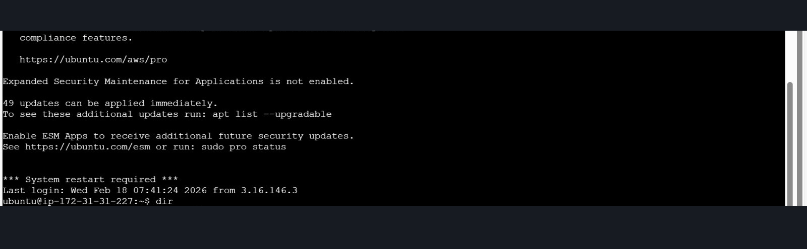
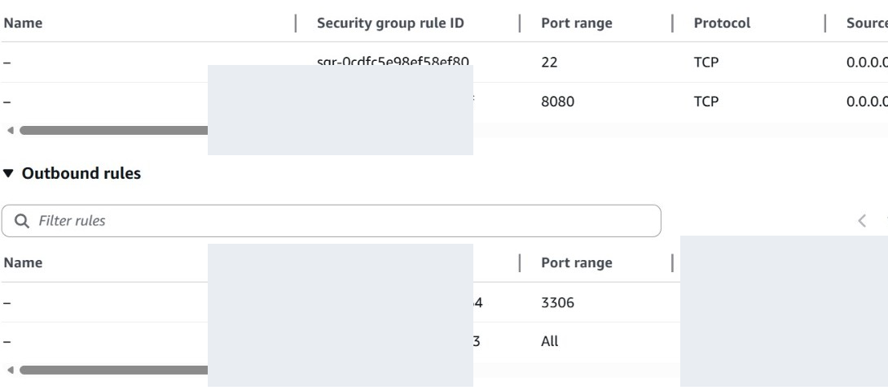

# Student Management REST API

A secure backend application built with **Java and Spring Boot** for managing student records through RESTful APIs.

This project demonstrates backend development concepts including layered architecture, MySQL database persistence, DTO validation, centralized exception handling, pagination and sorting, JWT-based authentication, and role-based authorization.

## Tech Stack

- Java 17
- Spring Boot
- Spring Web
- Spring Data JPA
- Hibernate
- Spring Security
- JWT
- MySQL
- Maven
- Jakarta Validation
- AWS EC2 and Amazon RDS MySQL (previous deployment)

## Features

- RESTful CRUD operations for student management
- Layered architecture using Controller, Service, and Repository layers
- DTO-based request and response handling
- Input validation using Jakarta Validation
- Centralized exception handling
- Pagination and sorting
- JWT-based authentication
- Spring Security integration
- Role-based authorization for USER and ADMIN roles
- BCrypt password hashing
- MySQL persistence using JPA/Hibernate
- Environment variables for database credentials and JWT secrets
- Public health-check endpoint

## Architecture

The backend follows a layered architecture:

```text
Client / React Frontend
        |
        v
StudentController
        |
        v
StudentService
        |
        v
StudentRepository
        |
        v
JPA / Hibernate
        |
        v
MySQL
```

## JWT Authentication Flow

```text
User sends username + password
        |
        v
AuthController
        |
        v
AuthenticationManager
        |
        v
Credentials verified
        |
        v
JwtService generates JWT
        |
        v
Client receives token
        |
        v
Authorization: Bearer <token>
        |
        v
JwtAuthFilter validates token
        |
        v
Spring Security authenticates request
        |
        v
Protected Student API
```

## API Endpoints

### Authentication

| Method | Endpoint | Description |
|---|---|---|
| POST | `/students/auth/register` | Register a new user |
| POST | `/students/auth/login` | Authenticate user and receive a JWT |

### Student Management

| Method | Endpoint | Description |
|---|---|---|
| POST | `/students/all` | Create a new student |
| GET | `/students/all` | Get all students |
| GET | `/students/{id}` | Get a student by ID |
| PUT | `/students/{id}` | Update a student |
| DELETE | `/students/{id}` | Delete a student (ADMIN only) |
| GET | `/students` | Get students with pagination and sorting |

### Health Check

```text
GET /public/health
```

Example response:

```json
{
  "status": "ok"
}
```

## Pagination and Sorting

Example request:

```text
GET /students?page=0&size=3&sortBy=id&direction=asc
```

Supported sorting fields:

- `id`
- `name`
- `course`

Supported directions:

- `asc`
- `desc`

## React Frontend

A separate React frontend integrates with this backend for authentication and student management.

- [Student Management Frontend](https://github.com/Shivachandra05/student-management-frontend)

## Previous AWS Deployment

This Spring Boot monolith was previously packaged as an executable JAR and deployed to an Ubuntu-based Amazon EC2 instance. Amazon RDS was used to provision a managed MySQL database.

The historical AWS configuration included:

- **Amazon EC2:** Ubuntu instance used for the Spring Boot JAR.
- **Amazon RDS:** MySQL 8.4.7 database instance (`db.t4g.micro`).
- **Security groups:** Rules included application port `8080` and MySQL port `3306`.
- **Application artifact:** `app.jar` present on the EC2 host.

These historical configuration screenshots support the infrastructure description but do not independently demonstrate a successful live API request or database connection. The prior cloud environment is no longer active.

### AWS Infrastructure Screenshots

The following screenshots document the previous AWS configuration. Sensitive identifying details have been obscured.

**Amazon RDS MySQL configuration**



**EC2 application files**



**EC2 security group rules**



## Project Status

- Backend REST API completed
- JWT authentication and role-based authorization implemented
- Previously deployed on AWS EC2 with Amazon RDS MySQL
- React frontend integrated with Spring Boot REST APIs
  
## Next Steps

- Add automated tests
- Containerize with Docker and Docker Compose
- Explore microservices architecture
